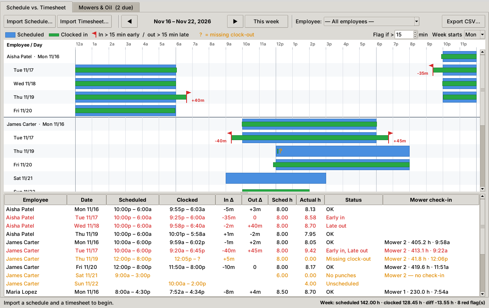
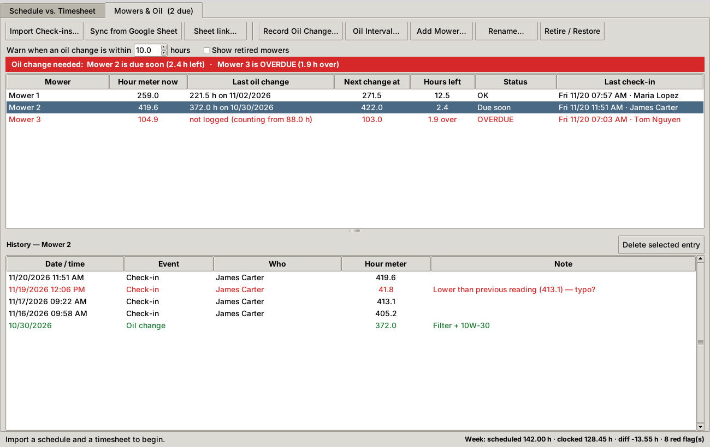

# TimeCompare: Schedule vs. Timesheet, plus Mower Oil Tracking

A free Windows desktop app (it also runs on Mac and Linux) that compares employee **schedules** with **clocked time**. It shows each week as an hourly grid and saves everything to a local SQLite database. There are no licenses or subscriptions.



| On the grid | Meaning |
|---|---|
| **Blue bar** | Scheduled shift |
| **Green bar** (drawn over the blue one) | Clock-in to clock-out. A split shift or lunch break shows as several green bars |
| **Red flag at the start** | Clocked in **more than 15 minutes before** the scheduled start |
| **Red flag at the end** | Clocked out **more than 15 minutes after** the scheduled end |
| **Orange ?** | Clock-in with no clock-out |

The table under the grid has one row per shift. Its columns are scheduled time, clocked time, in/out difference in minutes, scheduled hours, actual hours and status (OK, Early in, Late out, Missing clock-out, No punches, Unscheduled). The footer shows the week's totals. Hover over a bar to see its details in the status bar.

You can change the 15-minute threshold and the first day of the week (Sun or Mon) in the app. Both settings are saved.

## Mowers & Oil tab

The crew checks in on their phones at the start of each shift. They fill in a Google Form with their name, the mower they're taking, and its hour-meter reading. The app pulls those check-ins in and tells you when each mower needs an oil change.



- **Hour meter now:** the highest reading seen for that mower.
- **Next change at:** the hour meter at the last oil change plus that mower's oil interval. The interval defaults to 50 h; set it per mower with **Oil Interval…**.
- **Status:** OK, **Due soon** (within the warning hours, 10 by default), or **OVERDUE**. A banner across the top lists every mower that needs oil, and the tab title shows how many are due.
- **Record Oil Change…** (or double-click a mower) logs the date, the hour meter, and notes. The countdown restarts from that reading.
- **History** lists every check-in and oil change for the selected mower. Readings that go backwards or jump more than 100 h are marked as possible typos. They don't count toward the current hours.
- On the **Schedule vs. Timesheet** tab, the **Mower check-in** column shows which mower each person checked in on, with the reading and the time. If a mower was assigned in the schedule and nobody checked in on it, the row says *no check-in*.

If you've never logged an oil change for a mower, the app counts from its first check-in reading. Record the real last oil change once to make the countdown exact.

### Assigning mowers in the schedule (optional)
Add a column named `Mower` to the schedule file (for example `Mower 2`). The weekly table then shows when someone checked in on a different mower than the one they were scheduled for.

### Setting up the phone check-in (Google Form, free, about 15 minutes)

1. Go to <https://forms.google.com>, start a **Blank form**, and title it *Mower check-in*.
2. Add three questions, all **Required**:
   - **Your name**: *Dropdown*, with crew names typed exactly as they are in the schedule.
   - **Which mower?**: *Dropdown*, with mower names exactly as you want them in the app (`Mower 1`, `Mower 2`…).
   - **Hour meter reading**: *Short answer*. Under ⋮ → *Response validation*, choose *Number → Greater than → 0*.
3. **Responses** tab → **Link to Sheets** → *Create a new spreadsheet*.
4. **Send** → link icon → *Shorten URL* → copy. Text that link to the crew and have them add it to their phone's home screen.
5. *Optional, one QR code per mower:* ⋮ → **Get pre-filled link** → choose the mower → *Get link*. Turn each link into a QR code (search "free QR code generator"), print it, and tape it to that mower. Scanning it opens the form with the mower already filled in.

The crew doesn't need a Google account or an app. The form's timestamp records when they checked in.

### Getting check-ins into TimeCompare

- **Automatic (recommended):** in the linked Google Sheet, **Share → General access → Anyone with the link (Viewer)** → *Copy link*. In TimeCompare, click **Sheet link…** and paste it. The app then syncs every time it starts, and whenever you click **Sync from Google Sheet**. Check-ins that are already imported are skipped.
  - Anyone who has that link can view the sheet (names, mower, hour readings), so don't post it anywhere.
- **Manual:** in the Sheet, **File → Download → Comma-separated values (.csv)**, then **Import Check-ins…** in the app.

If a crew member types a wrong reading, fix or delete that row in the Google Sheet as well as in the app, or the next sync brings it back.

---

## Install (one time)

**Option A: run with Python (simplest)**
1. Install Python 3.10 or newer from <https://www.python.org/downloads/>. Tick **"Add python.exe to PATH"** during setup.
2. Copy this folder somewhere, for example `C:\TimeCompare`.
3. Double-click **`run.bat`**.

**Option B: build a standalone `TimeCompare.exe`**
1. Do step 1 above.
2. Double-click **`build_exe.bat`**. It creates `dist\TimeCompare.exe`.
3. Copy that .exe wherever you like. The database `timecompare.db` is created next to it.

The app needs nothing beyond Python's standard library. The build script also installs `openpyxl` so the .exe can read `.xlsx` files.

## Weekly workflow

1. **Import Schedule…** and pick the schedule export.
2. **Import Timesheet…** and pick the time-clock or timesheet export. You can select several files at once.
3. The app jumps to the imported week. Use ◀ ▶ to change weeks and **Employee** to look at one person.
4. **Export CSV…** saves the week's comparison for payroll or HR files.

Importing the same file again is safe. Records are matched on employee + start time, so a corrected file updates the existing rows (for example, a missing clock-out that has since been filled in) instead of duplicating them.

## File format

CSV, tab-delimited, or `.xlsx`. The column names are matched loosely, so most exports work as they are:

| Needed | Accepted column names (any case or spacing) |
|---|---|
| Employee | `Employee ID`, `Emp ID`, `Badge`, `ID` and/or `Name`, `Employee Name`, `First Name` + `Last Name` |
| Date | `Date`, `Work Date`, `Shift Date` (optional if start/end already include the date) |
| Start | `Start`, `Start Time`, `Shift Start`, `Clock In`, `Time In`, `Punch In` |
| End | `End`, `End Time`, `Shift End`, `Clock Out`, `Time Out`, `Punch Out` |

Accepted dates include `11/16/2026`, `2026-11-16`, `16-Nov-2026`. Accepted times include `8:00 AM`, `8:00a.m.`, `20:00`, `11/16/2026 8:00 PM`. Overnight shifts (end earlier than start) roll over to the next day automatically. Rows the app can't read are skipped and listed in a warning.

See `sample_data/` for examples you can import to try the app.

### Getting the data out of FileMaker (last time you'll need it)
In each layout: **File → Export Records…**, choose *Comma-Separated Values (.csv)*, and include the employee ID, name, date, start and end fields. To move your history over, export all past records once and import them here.

## The database

Everything lives in `timecompare.db`, a single SQLite file next to the app. To back up, copy that file. You can open it with the free [DB Browser for SQLite](https://sqlitebrowser.org/), Excel (via ODBC), or Power BI.

| Table | Contents |
|---|---|
| `employees` | id, name |
| `shifts` | scheduled shifts (employee_id, start, end, source_file, imported_at) |
| `punches` | clock records (employee_id, clock_in, clock_out, source_file, imported_at) |
| `comparisons` | saved results per week: deltas, `early_in_flag`, `late_out_flag`, hours, status, threshold used |
| `settings` | threshold, week start, oil warning hours, Google Sheet link |
| `mowers` | name, oil interval (hours), active |
| `checkins` | when, who, mower, hour-meter reading (from the phone form) |
| `oil_changes` | mower, date, hour meter at change, notes |

To use a different database file (for example, one per location): `python app.py --db "D:\HR\store2.db"`.

## Developer notes

```
timecompare/importer.py   file reading + flexible column/date parsing
timecompare/compare.py    matches punches to shifts, computes flags
timecompare/db.py         SQLite schema + import/upsert/save
timecompare/gui.py        Tkinter window, hourly grid, table
timecompare/mowers.py     check-in import / Google Sheet fetch, oil-change status
timecompare/mowers_gui.py Mowers & Oil tab
tests/                    python -m unittest discover -s tests -t .
```

Punches are assigned to the shift they overlap most. If a punch doesn't overlap any shift, it goes to the shift starting nearest to it, within 3 hours. A punch with no shift in range is reported as *Unscheduled*.
